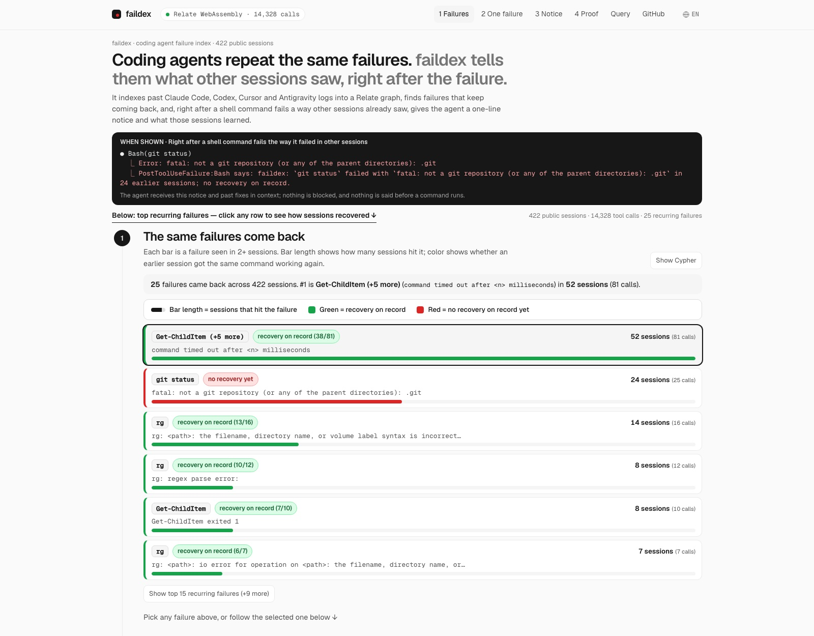
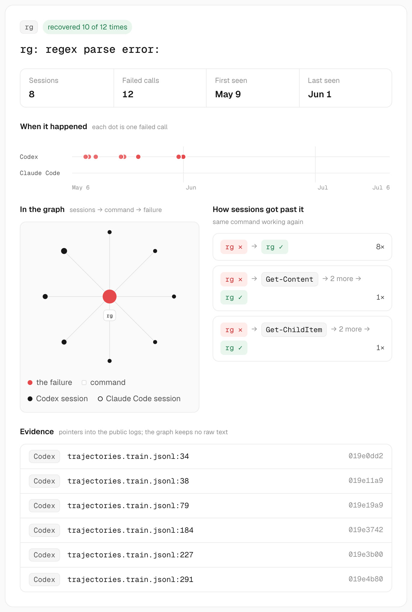

# faildex

[English](README.md) · **한국어**

코딩 에이전트를 위한 실패 색인입니다. faildex는 Claude Code, Codex, Cursor,
Antigravity의 세션 기록을 하나의 내장형 [Relate](https://github.com/relatedb/relate)
그래프로 모으고, 세션을 넘어 계속 되풀이되는 실패를 찾아, 그래프에서 해결 방법을
읽어 낸 뒤, 에이전트의 셸 명령이 다른 세션에서도 겪은 방식으로 실패하면 그 직후에
그 세션들이 배운 것을 알려 줍니다.

Relate by Neo4j 해커톤 출품작입니다.

```bash
curl -fsSL https://raw.githubusercontent.com/dtype2100/faildex/main/install.sh | sh   # macOS, Linux
faildex demo
```

Windows는 [설치](#설치)의 PowerShell 한 줄을 쓰세요.



*브라우저 데모는 공개 세션 422개로 그래프를 Relate WebAssembly 안에서 다시 만들고
화면의 모든 수치를 다시 계산합니다. <https://dtype2100.github.io/faildex/>에서 바로 열거나,
로컬에서 `make site && make serve`로 실행합니다.*

## 사용 순서

세 부분으로 나뉩니다. 처음 한 번은 순서대로 설정하고, 새 세션이 쌓이면 두 단계를
되풀이하고, 그다음 효과를 확인합니다. `faildex help`는 같은 순서를 터미널에 보여 주고,
`faildex --help`의 끝에는 첫 부분이 나옵니다. 아래 단계마다 복사할 명령과 무엇이 바뀌는지를
적었습니다. 명령별 자세한 내용은 [설치와 실행](#설치와-실행)에 있습니다.

### 처음 설치할 때 (한 번, 이 순서대로)

**1. 설치**

```bash
curl -fsSL https://raw.githubusercontent.com/dtype2100/faildex/main/install.sh | sh
```

설치 스크립트가 PATH에 폴더를 추가하라고 하면 먼저 `uv tool update-shell`을 실행합니다. 그다음
새 터미널을 열어 `faildex`가 PATH에 잡히게 한 뒤 확인합니다.

```bash
faildex --version
```

바뀌는 것: `faildex` 명령(없으면 uv도)을 설치합니다. 다른 것은 바꾸지 않습니다.
`faildex --version`은 설치된 버전을 보여 줍니다. Windows는 [설치](#설치)의 PowerShell 한 줄을 쓰세요.

**2. 공개 데이터로 맛보기**

```bash
faildex demo
```

바뀌는 것: 아무것도 쓰지 않습니다. faildex에 들어 있는 공개 기록으로 규칙, 명령이 실패한 직후의 알림, 수치를 보여 줍니다.

**3. 내 기록 모으기**

```bash
faildex ingest
```

바뀌는 것: 찾은 에이전트 기록 폴더로 개인 스토어 `~/.faildex/store`를 만듭니다. 이 컴퓨터 밖으로 나가지 않습니다. 이후 명령은 이 스토어를 읽습니다. 단, `FAILDEX_STORE`가 설정돼 있거나 자체 `./store`가 있는 faildex 저장소 폴더 안에서 실행하면 그쪽을 읽습니다.

**4. 규칙 제안을 보고 골라서 승인**

```bash
faildex rules
faildex rules --approve 1 3 --to ~/faildex-rules.md
```

바뀌는 것: `faildex rules`는 아무것도 쓰지 않고, 여러 세션에서 반복된 실패에 번호를 붙여 보여 줍니다. `--approve`는 고른 규칙(여기서는 1과 3)을 `~/faildex-rules.md`에 덧붙입니다.

**5. 에이전트에 연결**

```bash
faildex link
```

바뀌는 것: 이 컴퓨터에 있는 에이전트마다 설치합니다. Claude Code에는 `~/.claude/CLAUDE.md`에 규칙 파일을 가져오는 `@` 한 줄, `~/.claude/skills/faildex/`의 스킬, `~/.claude/settings.json`의 6단계 훅, Antigravity에는 규칙과 스킬을 담은 `faildex-rules` 플러그인, Codex와 Cursor에는 스킬과 `hooks.json`에 세션 시작 때 규칙을 불러오는 훅을 넣습니다(이전 버전이 넣은 셸 명령 전 faildex 훅은 지웁니다). `~/faildex-rules.md`가 없으면 만들기 때문에 승인 전에 실행해도 되고, 추가한 것을 `~/.faildex-link.json`에 적어 둡니다. Codex에서는 새 세션을 열기 전에 `/hooks`에서 새 훅을 검토하고 신뢰합니다.

**6. Claude Code 실패 직후 알림**

`faildex link`(5단계)가 `~/.claude/settings.json`에 아래 훅을 넣었습니다(`faildex hook --agent claude`로). `PreToolUse`에 있던 `faildex hook`은 지웠고, 이곳에 아직 없었으면 그 명령을 그대로 옮겼습니다. 한 프로젝트에서만 쓰려면 대신 그 프로젝트의 `.claude/settings.json`에 넣습니다(이미 `hooks`가 있으면 그 `PostToolUseFailure` 목록에 더합니다).

```json
{"hooks": {"PostToolUseFailure": [{"matcher": "Bash", "hooks": [
  {"type": "command", "command": "faildex hook", "timeout": 5}
]}]}}
```

바뀌는 것: 그 뒤에 시작한 Claude Code 세션부터(이미 실행 중인 세션에서는 `/hooks`에서 새 훅을 검토합니다) 셸 명령이 실패한 직후, 다른 세션에서 같은 명령이 같은 실패를 겪었으면 Claude에게 그 사실과 기록된 복구 방법을 알리고 화면에 한 줄 안내를 띄웁니다. 다른 대화 2개 이상(`--min-sessions`, 세션과 그 서브에이전트는 하나로 셈)에서 겪었을 때 말하고, 지금 세션과 그 서브에이전트는 세지 않습니다.

범위: 0이 아닌 종료 코드로 끝난 셸 호출에만 뜹니다. 스킬, 플러그인, 서브에이전트가 실행한 셸 명령도 포함합니다. 파이프나 `; echo`로 가린 실패는 종료 코드가 0이라 훅에 닿지 않고, MCP 도구나 파일 도구에는 뜨지 않습니다. 그런 반복 실패는 `faildex rules`에서 승인하면 세션이 시작될 때 규칙으로 전달됩니다. Codex와 Cursor는 세션 시작 때 규칙만 받습니다. `faildex link`는 어떤 에이전트에도 셸 명령 전 훅을 넣지 않고, 이전 버전이 넣은 것은 지웁니다. 실패 직후 알림은 이 둘에게는 범위 밖입니다(Cursor에는 faildex가 쓰지 않는 `postToolUseFailure`가 있고, Codex에는 실패 이벤트가 없습니다).

**7. 잘 됐는지 확인**

```bash
faildex check "git status"
```

바뀌는 것: 아무것도 쓰지 않습니다. 그 명령의 반복된 실패 중 경고할 만큼 잦은 것을 최대 3개, 복구 기록과 함께 보여 주고, 없으면 아무것도 출력하지 않습니다.

### 평소에 (새 세션이 쌓일 때마다 되풀이)

**1. 새 세션 모으기**

```bash
faildex ingest
```

바뀌는 것: 모든 기록을 다시 읽습니다. 스토어에 이미 있는 호출은 지금 기록 내용으로 바꾸고, 새 호출은 더하며, 기록 파일이 사라져도 스토어에서 지우지 않습니다.

**2. 새 규칙 승인**

```bash
faildex rules
faildex rules --approve 1 3 --to ~/faildex-rules.md
```

바뀌는 것: ingest 뒤에는 번호가 바뀌므로 먼저 목록을 봅니다. 승인한 규칙은 연결된 에이전트마다 다음 세션부터 적용되고, `faildex link`를 다시 하지 않아도 됩니다. Windows에서 Antigravity가 링크 대신 사본을 받았다면 다시 실행합니다.

### 효과 확인

**1. 내 기록으로 반복률 보기**

```bash
faildex eval --store ~/.faildex/store
```

바뀌는 것: 아무것도 쓰지 않습니다. 에이전트별로 세션을 시작 시각으로 나누고, 뒤 실패 중 앞에서 이미 일어난 것이 얼마인지 보여 줍니다.

**2. 어떤 날짜 전후 비교**

```bash
faildex report --split 2026-11-17
```

바뀌는 것: 아무것도 쓰지 않습니다. 내 스토어의 호출과 실패를 그 날짜 이전과 그 날짜부터로 나눠 셉니다.

### 되돌리기

```bash
faildex link --remove
```

- 이 명령은 `faildex link`가 설치하는 가져오기 줄, 스킬, 플러그인, 훅을 지웁니다. `~/faildex-rules.md`는 남습니다.
- `~/.claude/settings.json`의 `PostToolUseFailure`와 `PreToolUse`에서 `faildex hook` 항목도 빼고, 다른 훅과 설정은 그대로 둡니다. 프로젝트의 `.claude/settings.json`에 직접 넣은 `faildex hook`은 남습니다.
- `~/.faildex`를 지우면 개인 스토어와 저장된 언어가 사라지고, `--store` 없이 실행한 명령은 `FAILDEX_STORE`나 `./store`가 없으면 공개 데모 스토어를 씁니다.

### 출력 언어

출력은 기본이 영어입니다. `faildex lang ko`로 한국어로, `faildex lang en`으로 다시
영어로 바꿉니다(`~/.faildex/config.json`에 저장, 한 번만 바꾸려면 `--lang`, 셸 단위로는
`FAILDEX_LANG`이 먼저입니다). 훅과 MCP 응답, `--approve`가 쓰는 규칙 문장, JSON, 실패 키는
영어 그대로 둡니다. 에이전트가 읽고, 규칙 파일의 중복 판단도 그 문장으로 하기 때문입니다.
`faildex help <명령>`은 명령 하나를 예와 함께 설명합니다.

## 무엇을 해결하나

코딩 에이전트는 기억하지 못합니다. 한 세션이 `fatal: not a git repository`를 만나
이유를 알아내도, 다음 세션은 같은 실패를 또 만납니다. 에이전트마다 기록 형식이
달라서 세션 사이에도, 에이전트 사이에도 아무것도 이어지지 않습니다.

이 저장소에 들어 있는 공개 세션 기록에서 **뒤 기간 세션의 실패 중 68%는 앞선 세션에서
이미 일어난 실패**였고, 그중 60%는 앞선 세션에 같은 명령이 몇 번 뒤에 다시 성공한
기록까지 있었습니다. 에이전트가 디스크에 갖고 있으면서도 쓰지 못한 지식입니다.

faildex는 이것을 다음 도구로 바꿉니다.

| 실행 | 얻는 것 |
|---|---|
| `faildex rules` | 세션을 넘어 되풀이된 실패에 대한 규칙 제안. 각 제안에는 기록된 복구 방법과 로그 위치가 붙습니다. 승인한 것만 규칙 파일에 기록됩니다. |
| `faildex hook` | Claude Code `PostToolUseFailure` 훅. 셸 명령이 실패한 직후, 다른 세션에서 같은 명령이 같은 실패를 겪었으면 세션에 한 줄 알림을 띄우고 Claude에게 그 세션들이 배운 내용을 전달합니다. 그 밖에는 아무것도 출력하지 않습니다. Codex와 Cursor에는 세션이 시작될 때 승인한 규칙을 불러옵니다. |
| `faildex mcp` | MCP 도구 `preflight`, `evidence`, `recurring`. 어떤 MCP 에이전트든 실행 전에 물어볼 수 있습니다. |
| `faildex eval` | 위 수치를 저장소의 스토어로 다시 계산합니다. 공개 데이터셋이 없는 내 스토어(`--store ~/.faildex/store`)에서는 같은 분할을 에이전트별로 합니다. |
| `faildex ingest` | 내 Claude Code, Codex CLI, Cursor, Antigravity 기록을 내 컴퓨터의 개인 스토어(`~/.faildex/store`)에 적재합니다. 위의 모든 명령이 이 스토어를 씁니다. |
| `faildex report` | 내 스토어에서 날짜 전후의 건수를 셉니다: 호출, 실패, 고른 실패 하나, 훅이 보낸 알림. |

### 실패 하나를 그래프로 따라가기

브라우저 데모에서 실패를 고르면 언제 일어났는지, 그래프 속 이웃(그 실패를 겪은
세션과 명령), 세션들이 어떻게 넘어갔는지, 근거가 된 로그 위치를 볼 수 있습니다.



## Relate를 어떻게 쓰나

세션 하나의 기록은 목록입니다. "이 실패가 전에도 있었나, 무엇으로 넘어갔나?"는
여러 목록을 가로지르는 경로의 질문이라서 데이터를 그래프에 둡니다.

```
(Source)<-[:FROM]-(Session)-[:HAS_CALL]->(Call)-[:NEXT]->(Call)
                                          |  \
                                       [:RAN] [:FAILED_WITH]
                                          v        v
                                      (Command) (ErrorSig)
```

`Command`와 `ErrorSig` 노드는 모든 세션과 모든 에이전트가 공유합니다. 한 번 본
실패는 같은 실패를 겪은 다른 모든 세션과 한 단계 거리에 있고, 그 세션이 회복한
방법과는 짧은 `NEXT` 경로로 이어집니다.

```cypher
MATCH (k:Command {template: $command})<-[:RAN]-(f:Call)-[:FAILED_WITH]->(e:ErrorSig)
MATCH p = (f)-[:NEXT*1..5]->(g:Call {ok: true}), (g)-[:RAN]->(k)
RETURN e.sig, min(length(p)) AS calls_until_it_worked
```

Relate를 쓰는 곳:

- **내장형 디렉터리 스토어.** `store/`는 이 저장소에 커밋된 Relate 데이터베이스입니다.
  띄울 서버가 없고, `relate.connect("store", read_only=True)`가 설정의 전부입니다.
- **가변 길이 경로를 쓰는 Cypher**로 복구 경로를 찾고, 키가 있는 노드에 `MERGE`를 써서
  같은 기록을 두 번 적재해도 바뀌지 않습니다.
- **모든 키에 유일 제약.** 키 색인 역할도 해서, 호출 4,000건 적재가 제약이 있으면 0.6초,
  없으면 60초 걸립니다.
- **쓰는 쪽 하나, 읽는 쪽 여럿.** 적재가 쓰는 동안 훅과 MCP 서버는 스토어를 읽기 전용으로 엽니다.
- **모든 화면이 쓰는 질의 계층 하나.** `faildex rules`, 훅, MCP 도구가
  [`insight.py`](src/faildex/insight.py)의 같은 함수를 불러서 서로 다른 답을 낼 수 없습니다.

스키마는 [docs/schema.md](docs/schema.md)에 있습니다. 그래프는 명령이나 출력의 원문을
저장하지 않습니다. 명령은 틀(`git push`)로, 실패는 가린 서명으로 바뀌고, 호출마다
로그 줄의 위치만 남깁니다.

## 설치와 실행

### 설치

| | 한 줄 설치 | 필요한 것 |
|---|---|---|
| macOS | `curl -fsSL https://raw.githubusercontent.com/dtype2100/faildex/main/install.sh \| sh` | 터미널, git(Xcode 명령줄 도구) |
| Linux | `curl -fsSL https://raw.githubusercontent.com/dtype2100/faildex/main/install.sh \| sh` | curl과 git이 있는 셸 |
| Windows | `powershell -ExecutionPolicy ByPass -c "irm https://raw.githubusercontent.com/dtype2100/faildex/main/install.ps1 \| iex"` | PowerShell. git은 필요 없음 |

각 스크립트는 [uv](https://docs.astral.sh/uv/)가 없으면 먼저 설치하고, 이어서 `faildex`
명령을 설치합니다. 다른 것은 바꾸지 않습니다. 먼저 읽어 보고 싶다면
[install.sh](install.sh)와 [install.ps1](install.ps1)를 보세요. 각각 30줄 정도입니다.
uv가 이미 있다면 직접 이렇게 해도 됩니다.

```bash
uv tool install git+https://github.com/dtype2100/faildex      # macOS, Linux
uv tool install https://github.com/dtype2100/faildex/archive/refs/heads/main.zip   # Windows, git 없이
```

설치 후 새 터미널을 열어야 `faildex`가 PATH에 잡힙니다(설치 스크립트가 PATH에 폴더를 추가하라고
하면 먼저 `uv tool update-shell`을 실행합니다). 그다음 어느 폴더에서든
(전체 순서는 [사용 순서](#사용-순서)에 있습니다):

```bash
faildex demo                  # 공개 기록으로 규칙 제안, 실패 직후 알림, 수치를 보여 줌
faildex check "git status"    # 이 명령에 알려진 실패가 있는지
```

CI에서 macOS, Linux, Windows 모두 설치하고 실행합니다. Windows에서 심볼릭 링크를 만들 수
없으면 `faildex link`는 규칙 파일을 Antigravity 플러그인에 복사합니다. 규칙을 새로 승인한
뒤 다시 실행하세요.

`faildex demo`는 다운로드, API 키, 설정이 필요 없습니다. 공개 스토어가 패키지에
들어 있습니다. 몇 초면 끝납니다.

#### Windows (PowerShell)

인터넷에 연결된 PowerShell 5.1 또는 7에서 실행하세요. 위 한 줄 설치는 uv가 없으면
먼저 설치합니다. uv가 Python을 관리하며, faildex에는 Python 3.10 이상이 필요합니다.
ZIP 방식은 git이 필요 없습니다. git이 있다면 위 `git+https://...` 명령도 Windows에서
동작합니다. 재설치하거나 설치 방식을 바꿀 때는 `uv tool install` 뒤에 `--force`를 붙이세요.

새 PowerShell 창에서 설치를 확인하세요.

```powershell
Get-Command faildex
faildex --help
faildex demo
faildex sources
faildex ingest
```

`ingest`는 Windows 사용자 프로필 아래의 에이전트 기록을 찾아 개인 스토어를
`~/.faildex/store`에 저장합니다. 기본 기록 폴더가 없으면
`no agent logs in the default folders`를 출력하고 종료 코드 1을 반환합니다.
`--claude`, `--codex-sessions`, `--cursor`, `--antigravity`로 실제 폴더를 지정하세요.

새 창에서도 `faildex`를 못 찾으면 `uv tool update-shell`을 실행하고 PowerShell을
다시 여세요. 현재 창에만 적용하려면 `$env:Path = "$(uv tool dir --bin);$env:Path"`를
실행하세요. PowerShell 5.1의 `>`는 UTF-16으로 저장하므로 UTF-8 도구에 넘길 출력은
`| Set-Content -Encoding UTF8`로 저장하세요(PowerShell 5.1에서는 BOM 포함).
외부 명령 직후 `$LASTEXITCODE`를 확인하세요.
`| Select-Object -First N`은 출력을 중간에 끊어 종료 코드가 0이 아니게 만들 수 있습니다.

uv·Python·git이 이미 설치된 Windows 10 22H2, PowerShell 5.1, uv 0.9.10,
Python 3.13.5 환경에서 세 가지 설치 방식,
CLI 확인, 기본 경로 적재, 임시 프로필의 `link`·`link --remove`가 통과했습니다.
[명령·결과·검증 범위](docs/windows-install-verification.md)를 참고하세요.

### 저장소에서 직접

필요한 것: Python 3.10 이상과 uv. CI에서 macOS, Linux, Windows로 시험합니다.

```bash
git clone https://github.com/dtype2100/faildex && cd faildex
make setup     # 의존성과 비밀 정보 검사 훅
make demo      # 같은 데모를 커밋된 스토어로
make eval      # 평가 표만
make test      # 테스트 160개 이상
make install   # 이 저장소를 `faildex` 명령으로 PATH에 올림
```

공개 데이터셋으로 스토어를 다시 만들기(내려받기 약 120MB):

```bash
make data          # 두 데이터셋을 고정된 리비전으로 내려받음
make build-store   # store/를 쓰고 노드 수, 크기, 메모리를 출력
```

브라우저 데모를 로컬에서 실행하기(`npm pack` 한 번에 Node 필요):

```bash
make site      # 스토어를 site/data.json으로 내보내고 Relate WebAssembly를 받음
make serve     # http://localhost:8765
```

페이지는 그래프를 Relate WebAssembly 안에서 다시 만들고 평가를 브라우저에서 다시
계산해 같은 80/117에 도달합니다. 패널마다 "Cypher 보기" 버튼으로 뒤에 있는 질의를 볼 수
있고, 콘솔에서 직접 질의할 수 있습니다. 페이지는 영어와 한국어를 지원합니다. 상단의
지구본 메뉴에서 고르거나 `?lang=ko`로 여세요.

내 기록 적재하기. 기록은 내 컴퓨터의 `~/.faildex/store`에만 남습니다. 아래는
[처음 설치할 때](#처음-설치할-때-한-번-이-순서대로)의 3~5단계이고, 단계마다 무엇이 바뀌는지는 그 절에 있습니다.

```bash
faildex ingest    # 기본 폴더를 찾아 모두 읽음. 다른 위치는 --claude, --codex-sessions, --cursor, --antigravity DIR
faildex rules
cd ~ && faildex rules --approve 1 3   # 원하는 규칙만 ~/faildex-rules.md에 기록
faildex link      # 스킬·규칙, Claude Code 실패 직후 훅, Codex/Cursor 세션 시작 훅 설치. --remove로 되돌림
```

`faildex rules --top 2` 출력 예시(공개 스토어 기준):

```text
Public demo logs (./store): 422 sessions, 627 failed calls, 25 recurring
Note: this is demo data. Index your own logs with: faildex ingest

1. `Get-ChildItem` +4 more commands — command timed out after <n> milliseconds
   52 sessions, 81 failed calls · 38 of 81 recovered within 5 calls
   Action: retry the same command; a later try worked in 21 of 38 recoveries.
   evidence (3): codex-trajectories/trajectories.train.jsonl:18, +2 more

2. `git status` — fatal: not a git repository (or any of the parent…
   24 sessions, 25 failed calls · 0 of 25 recovered within 5 calls
   Action: stop and check before retrying; no recovery on record yet.
   evidence (3): codex-trajectories/trajectories.train.jsonl:18, +2 more

Showing 2 of 25 recurring (--top 25 for all); full evidence paths: --evidence
Write a rule: faildex rules --approve 1 2 --to ~/faildex-rules.md
```

숫자는 실패 하나를 기준으로, 그 실패를 겪은 모든 명령을 합친 값입니다(`+4 more commands`).
"recovered within 5 calls"는 실패한 호출 뒤 5번 안에 같은 명령이 성공한 횟수이고,
"21 of 38 recoveries"는 그 복구 가운데 Action 줄의 방법을 쓴 횟수입니다.
Action은 저절로 풀리는 실패(시간 초과, 연결 거부나 재설정, 요청 한도와 서버 오류, 잠금)에만
"retry"라고 쓰고, 다른 실패에는 원인을 고친 뒤 다시 실행하라고 씁니다. zsh 글롭이나 `=` 실패에는
정해진 해결(그 단어를 따옴표로 감싸기)을 붙입니다.
`--evidence`는 근거 위치(세션 최대 3개)를 줄이지 않고 보여 줍니다.

`--store`가 없으면 명령은 `FAILDEX_STORE` 환경 변수가 가리키는 스토어를, 없으면 `./store`(저장소 안),
`~/.faildex/store`, 공개 데모 스토어 순으로 씁니다. `report`는 `./store`보다 `~/.faildex/store`를 먼저 찾고,
`ingest`는 언제나 `~/.faildex/store`에 쓰며, `export-web`은 `./store`나 공개 데모 스토어를 읽되 그 스토어에 내 기록이 있으면 쓰지 않고 멈추며, 다른 스토어는 `--store`로 넘길 때만 내보냅니다.

옵션 없이 실행하면 `~/.claude/projects`, `~/.codex/sessions`, `~/.cursor/chats`,
`~/.gemini/antigravity-cli`, `~/.gemini/antigravity` 중 있는 폴더를 모두 읽습니다.

Claude Code에서 쓰기. `faildex link`가 모든 세션용으로 `~/.claude/settings.json`에 넣습니다
([처음 설치할 때](#처음-설치할-때-한-번-이-순서대로)의 6단계). 한 프로젝트에서만 쓰려면 그 프로젝트의
`.claude/settings.json`에 직접 넣으세요. `faildex ingest`를 실행한 뒤에는 내 스토어를,
그 전에는 공개 스토어를 읽습니다.

```json
{"hooks": {"PostToolUseFailure": [{"matcher": "Bash", "hooks": [
  {"type": "command", "command": "faildex hook", "timeout": 5}
]}]}}
```

Codex와 Cursor는 세션 시작 때 규칙만 받습니다(`faildex link`가 설치). 실패 직후 알림은
이 둘에게는 범위 밖입니다.

`faildex ingest`를 손으로 돌리지 않고 스토어를 최신으로 두려면 그 명령에
`--refresh-every 10`을 붙이세요(`"command": "faildex hook --refresh-every 10"`).
훅은 셸 호출이 실패했을 때만 불리므로 실패한 호출만 셉니다. 그 10번마다, 그리고 적어도
하루에 한 번(실패가 났을 때 확인) 훅이 `faildex ingest`를 백그라운드로 띄우고 바로 끝납니다.
지난 갱신을 시작한 뒤 30분 안에는 다시 띄우지 않습니다. 10은 예전 권장값인 호출 200번과
비슷한 주기입니다. 공개 Claude Code 기록에서 셸 호출 1,415건 중 65건이 실패했습니다.
`--store`나 `FAILDEX_STORE`로 지정한 스토어를, 둘 다 없으면 `~/.faildex/store`를 갱신하고, `./store`는 갱신하지 않습니다.
자세한 내용은 [스토어를 최신으로 두기](docs/agent-hooks.md#keeping-the-store-current)를 보세요.

MCP 클라이언트에서 쓰기:

```json
{"mcpServers": {"faildex": {"command": "faildex", "args": ["mcp"]}}}
```

에이전트에게 이 도구를 언제 부를지 알려 주는 스킬은
[`skills/faildex/SKILL.md`](skills/faildex/SKILL.md)에 있습니다. `faildex link`가 Claude Code(`~/.claude/skills/faildex/`),
Antigravity(`faildex-rules` 플러그인 안; `--rules` 경로를 바꾸어 다시 실행하면
faildex가 만든 심볼릭 링크를 새 경로로 다시 걸고 사용자 파일은 그대로 둠),
Codex(`~/.codex/skills/faildex/`), Cursor(`~/.cursor/skills/faildex/`)에 설치하고,
`faildex link --remove`가 faildex가 만든 항목만 지웁니다.

Codex와 Cursor의 사용자 `hooks.json`에는 세션 시작 시 근거 줄을 뺀 규칙을
불러오는 훅 하나를 등록합니다. 셸 명령 전에 도는 훅은 넣지 않고, 이전 버전이 넣은
faildex 훅은 지웁니다. 기존 훅은
보존하고 변경 전에 백업하며, 제거 시 faildex 항목만 뺍니다. Codex는 `/hooks`에서
새 명령을 검토·신뢰한 뒤 새 세션을 시작해야 합니다. [훅 설정](docs/agent-hooks.md)을 참고하세요.

Cursor CLI는 훅을 지원하지만, `2026.11.19-f005e9d` 확인에서는 다른 도구의 항목이
포함된 기존 설정으로 훅이 실행되지 않았습니다. 최소 탐침 설정에서는 실행됐으며,
원인 항목은 아직 확인하지 못했습니다. 다른 도구의 훅은 보존하고 조사 중에는
설치된 스킬과 [CLI 규칙](https://cursor.com/docs/cli/using#rules)을 사용하세요.
[실험 결과와 확인 방법](docs/agent-hook-verification.md)을 남겼습니다.

## 데이터는 어디에 있나

- **`store/`**가 저장된 Relate 스토어입니다: 세션 422개, 도구 호출 14,328건,
  실패한 호출 627건, 관계 38,338개, 0.85MB. `faildex.store.open_store`가 새로 받은
  저장소에서 처음 열 때까지 포함해 엽니다.
- 공개 데이터셋 두 개로만 만들었고, 둘 다 MIT 라이선스이며
  [`build.py`](src/faildex/build.py)에 리비전이 고정돼 있습니다:
  [`crispwisp/wisp-claude-code-sessions`](https://huggingface.co/datasets/crispwisp/wisp-claude-code-sessions)
  (Claude Code),
  [`israellaguan/codex-tool-use-trajectories`](https://huggingface.co/datasets/israellaguan/codex-tool-use-trajectories)
  (Codex). 각 `Session`은 데이터셋, 리비전, 라이선스를 담은 `Source` 노드와 이어집니다.
- 이 저장소에는 개인 기록이 없습니다. 공유 스토어는 쓰는 순간 로컬 경로를 거부하고,
  커밋할 때마다 비밀 정보 검사가 돕니다.

## 평가

`make eval`은 데이터셋마다 세션을 시작 시각으로 나눠(앞 70%는 앞 기간, 뒤 30%는 뒤 기간)
뒤 기간에 일어난 실패 중 얼마나 많은 것이 이미 그래프에 있었는지 셉니다.

| | 뒤 기간 실패 | 앞 기간에 이미 있던 것 | 그중 복구 기록도 있던 것 |
|---|---|---|---|
| 모든 실패 키 | 117 | 80 (68.4%) | 48 (60.0%) |
| 실패 문구만 | 102 | 72 (70.6%) | 45 (62.5%) |

이 수치가 보여 주는 것과 보여 주지 않는 것은 [docs/evaluation.md](docs/evaluation.md)에
있습니다. 요약하면, 지식이 이미 있었다는 것을 보여 줄 뿐 경고를 받은 에이전트가 그에
따라 행동했을지는 보여 주지 않습니다. Codex 데이터셋은 Windows 프로젝트를 하는 개발자
한 명의 기록이고, 실패 하나(`command timed out`)가 80건 중 31건입니다. 이를 빼면 반복
비율은 57%입니다.

명령 전에 경고하던 faildex의 이전 훅(지금은 없음, 아래 참고)이 실제로 말했을지는 다른 질문입니다. 그 훅의 규칙을 뒤 기간에 그대로 다시 돌리면,
뒤 기간 셸 호출 5,070개 중 206개(4.1%) 앞에서 경고했을 것입니다. 그 가운데 10개가 경고가
짚은 바로 그 실패로 끝났고, 이는 뒤 기간 실패 117개 중 10개입니다. 10개 중 9개가 한 세션에
있고, 나누는 지점을 50~90%로 옮기면 0~22개로 바뀌므로(커밋된 스토어로 테스트가 다시 계산) 이
숫자는 이 기록의 묘사이지 비율이 아닙니다. 복구 기록이 있는 48개 중 훅이 경고했을 것은 없습니다. 자세한 내용은
[docs/evaluation.md](docs/evaluation.md#would-the-hook-have-spoken)에 있습니다.

Claude Code로 일곱 작업을 그 이전 훅을 끄고 켠 채 각각 10번 돌린 작은 통제 벤치에서, 경고는 첫 시도의 실패를
줄이지 못했습니다(어느 쪽이든 70회 중 20회). 실패가 첫 호출에서 나고 경고는 호출을 막지 않기
때문입니다. git 저장소 안에서도 훅은 그곳에서는 일어날 수 없는 git 실패를 호출 20번 앞에서 경고했습니다
([벤치](docs/evaluation.md#controlled-bench)). 이 결과 때문에 faildex는 이제 명령 전에는
경고하지 않고 실패 직후에만 말합니다.

## 여러 에이전트에 걸쳐, 실제 기록에서

공개 데이터셋으로는 에이전트 사이의 경우를 보여 줄 수 없습니다. 하나는 Windows의
PowerShell, 다른 하나는 Linux의 bash라서 둘 다에 나오는 실패가 없습니다. 작성자의 기록으로는
보여 줄 수 있습니다. 아래는 2026-11-17에 `faildex ingest`로 만든 개인 스토어에서
`faildex report`로 센 건수입니다. 기록은 이 저장소에 없으므로 이 수치는 다시 계산할 수
없습니다. 같은 두 명령을 내 기록에 실행하면 내 수치를 얻을 수 있습니다.

| 에이전트 | 세션 | 도구 호출 | 실패 |
|---|---|---|---|
| Claude Code | 190 | 19,443 | 364 |
| Codex | 39 | 1,786 | 101 |
| Cursor | 59 | 2,538 | 94 |

- **실패 키 12개를 두 개 이상의 에이전트가 겪었습니다.** 한 에이전트가 겪은 실패를 다른
  에이전트도 이미 겪었습니다.
- 실패 키 57개가 두 개 이상의 세션에서 되풀이됐고, 그중 13개에 복구 기록이 있습니다.
- 이전의 명령 전 경고는 가려서 말했습니다. 명령 틀 197개 중 7개에만 경고가 붙었을 것입니다.

## 심사 기준

| 기준 | 볼 곳 |
|---|---|
| Relate와 연결된 맥락의 활용 | 공유 `Command`/`ErrorSig` 노드가 있는 스키마, `NEXT` 경로로 읽는 복구, 제약, 커밋된 디렉터리 스토어, 쓰는 쪽 옆의 읽기 전용 읽는 쪽, 브라우저 데모의 Relate WebAssembly에서 도는 같은 그래프와 질의, 실패마다 그려지는 이웃 |
| 기능 | 한 줄 설치와 `faildex demo`; `faildex rules`, `check`, `hook`, `mcp`, `eval`, `ingest`, `report`, `build-store`; Relate WebAssembly 브라우저 데모; macOS·Linux·Windows CI |
| 유용성 | 뒤 기간 실패의 68%가 이미 그래프에 있었음; 합성 시드 스토어로 한 실제 Claude Code 실행 1회(`claude -p`, Haiku)에서 Claude가 명령이 실패한 직후 훅의 알림을 받아 그대로 인용함. 전달 확인이며 효과가 아님(반복 감소는 [측정하지 않음](docs/evaluation.md#notices-right-after-a-failure-claude-code-posttoolusefailure)); 다른 세션도 같은 실패를 겪었을 때만 말하고 나머지에는 침묵; 작성자 기록에서 세 에이전트가 공유한 실패 키 12개 |
| 문서와 재현성 | 이 파일, `docs/schema.md`, `docs/evaluation.md`(방법의 각 규칙을 지키는 테스트와 짝지음); 모든 수치는 커밋된 스토어에서 `make eval`로 나오고, 문서가 다르면 테스트가 실패하며, WebAssembly 빌드도 같은 수치에 도달 |
| 창의성 | 한 에이전트가 배운 실패가 다음 세션의 규칙과 알림이 되고, 로그 위치가 근거로 붙음 |

## AI 사용

이 프로젝트는 AI 코딩 에이전트와 함께 만들었습니다. 구현은 Claude Code(Claude), 독립
코드 검토는 Codex가 맡았습니다. 설계 결정, 데이터 선택, 결과 검토는 작성자가 했습니다.

## 라이선스

Apache-2.0. 데이터셋 라이선스는 위에 적었습니다.
