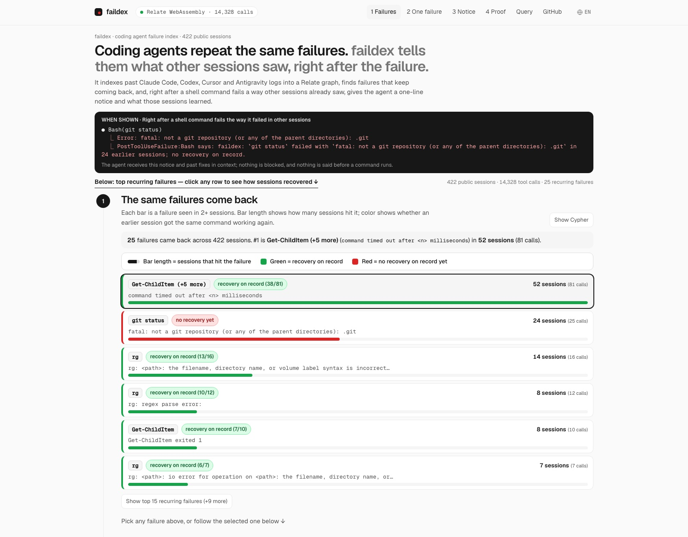
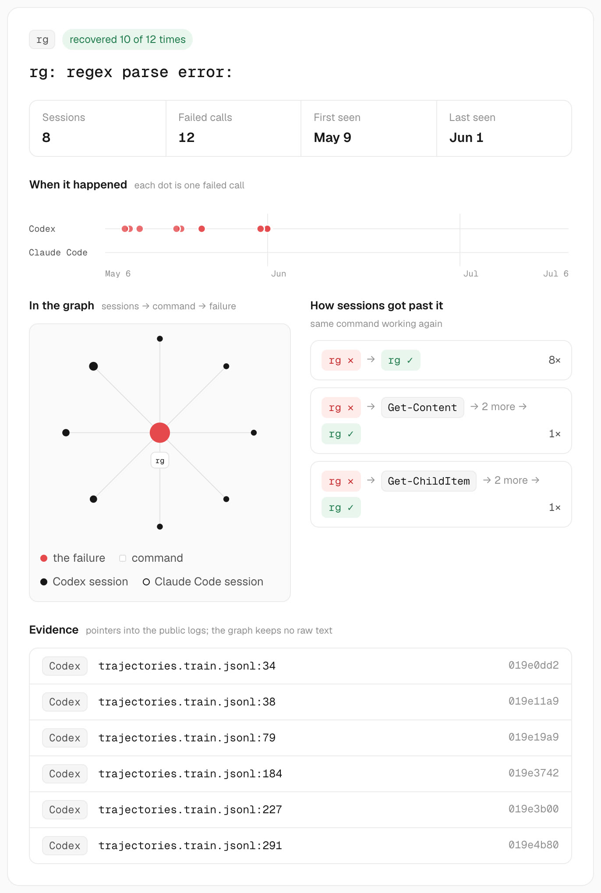

# faildex

**English** · [한국어](README.ko.md)

A failure index for coding agents. faildex reads the session logs of Claude Code,
Codex, Cursor and Antigravity into one embedded [Relate](https://github.com/relatedb/relate) graph,
finds the failures that keep coming back across sessions, reads the way out off
the graph, and tells the agent before it runs the same command again.

Built for the Relate by Neo4j Hackathon.

```bash
curl -fsSL https://raw.githubusercontent.com/dtype2100/faildex/main/install.sh | sh   # macOS, Linux
faildex demo
```

On Windows, see [Install](#install) for the PowerShell line.



*The browser demo rebuilds the graph from 422 public sessions inside Relate
WebAssembly and recomputes every number on the page. Open it at
<https://dtype2100.github.io/faildex/>, or run it locally with `make site && make serve`.*

## Use case

Coding agents do not remember. A session hits `fatal: not a git repository`,
works out why, and the next session hits it again. Each agent keeps its own log
format, so nothing carries over between sessions or between agents.

On the public session logs committed with this repository, **68% of the failures
in the later sessions had already happened in an earlier session**, and for 60%
of those an earlier session also shows the same command succeeding a few calls
later. That is knowledge the agent had on disk and could not reach.

faildex turns it into three things:

| You run | You get |
|---|---|
| `faildex rules` | Rule proposals for failures that recurred across sessions, each with the recovery on record and pointers to the log lines. Only the ones you approve are written to a rules file. |
| `faildex hook` | A Claude Code `PreToolUse` hook. Before a command with a known recurring failure it shows a one-line notice in the session and gives Claude what earlier sessions learned. It speaks only when that failure is at least 3% of the command's runs (or, for the pooled `zsh` shell failures, `no matches found` for an unquoted glob and `=<word> not found` for an unquoted word starting with `==`, when the command line has that construct and the failure recurred across `min_sessions` sessions), and prints nothing otherwise. |
| `faildex mcp` | MCP tools `preflight`, `evidence` and `recurring`, so any MCP agent can ask before it acts. |
| `faildex eval` | The numbers above, recomputed from the committed store. On your own store (`--store ~/.faildex/store`), which has no public datasets, the same split runs per agent. |
| `faildex ingest` | Your own Claude Code, Codex CLI, Cursor and Antigravity logs in a private store on your machine (`~/.faildex/store`), which every command above then uses. |
| `faildex report` | Counts before and after a date on your own store: calls, failures, one failure of your choice, and warnings the hook gave. |

### In a real Claude Code session

The agent runs `git status` in a folder that is not a repository. Before the
result comes back, the faildex hook prints what earlier sessions learned, and
Claude acts on it:


### One failure, followed through the graph

Select a failure in the browser demo to see when it happened, its neighbourhood
in the graph (the sessions and commands that hit it), how sessions got past it,
and the log lines behind it:



## How it uses Relate

The log of one session is a list. The question "has this failed before, and what
got past it?" is a path across many lists, which is why the data lives in a graph.

```
(Source)<-[:FROM]-(Session)-[:HAS_CALL]->(Call)-[:NEXT]->(Call)
                                          |  \
                                       [:RAN] [:FAILED_WITH]
                                          v        v
                                      (Command) (ErrorSig)
```

`Command` and `ErrorSig` nodes are shared by every session and every agent. A
failure seen once is one hop from every other session that hit it and a short
`NEXT` path from how that session recovered:

```cypher
MATCH (k:Command {template: $command})<-[:RAN]-(f:Call)-[:FAILED_WITH]->(e:ErrorSig)
MATCH p = (f)-[:NEXT*1..5]->(g:Call {ok: true}), (g)-[:RAN]->(k)
RETURN e.sig, min(length(p)) AS calls_until_it_worked
```

What Relate is used for:

- **Embedded directory store.** `store/` is a Relate database committed to this
  repository. There is no server to start; `relate.connect("store", read_only=True)` is the whole setup.
- **Cypher with variable-length paths** for recoveries, and `MERGE` on keyed nodes
  so that loading the same log twice changes nothing.
- **Uniqueness constraints** on every key. They also index the keys: loading
  4,000 calls takes 0.6 s with them and 60 s without.
- **One writer, many readers.** The hook and the MCP server open the store
  read-only while an ingest is writing.
- **One query layer for every surface.** `faildex rules`, the hook and the MCP
  tools call the same functions in [`insight.py`](src/faildex/insight.py), so
  they cannot disagree.

The schema is in [docs/schema.md](docs/schema.md). The graph never stores a raw
command or raw output: commands become templates (`git push`), failures become
masked signatures, and each call keeps a pointer to its log line.

## Setup and run

### Install

| | One line | Needs |
|---|---|---|
| macOS | `curl -fsSL https://raw.githubusercontent.com/dtype2100/faildex/main/install.sh \| sh` | Terminal; git (Xcode command line tools) |
| Linux | `curl -fsSL https://raw.githubusercontent.com/dtype2100/faildex/main/install.sh \| sh` | any shell with curl and git |
| Windows | `powershell -ExecutionPolicy ByPass -c "irm https://raw.githubusercontent.com/dtype2100/faildex/main/install.ps1 \| iex"` | PowerShell; no git needed |

Each script installs [uv](https://docs.astral.sh/uv/) if you do not have it, then
the `faildex` command, and changes nothing else. Read them first if you prefer:
[install.sh](install.sh) and [install.ps1](install.ps1), about thirty lines each.
With uv already installed, the same thing by hand:

```bash
uv tool install git+https://github.com/dtype2100/faildex      # macOS, Linux
uv tool install https://github.com/dtype2100/faildex/archive/refs/heads/main.zip   # Windows, without git
```

Open a new terminal afterwards so `faildex` is on your PATH. Then, from any folder:

```bash
faildex demo                  # rules, a pre-run warning and the numbers, on public logs
faildex check "git status"    # what is known to go wrong with a command
```

CI installs and runs faildex on macOS, Linux and Windows. On Windows, `faildex link`
copies the rules file into Antigravity's plugin when symlinks are not allowed;
run it again after approving new rules.

`faildex demo` needs no download, no API key and no setup: the public store ships
inside the package. It takes a few seconds.

#### Windows (PowerShell)

Use PowerShell 5.1 or 7 with internet access. The one-line installer above installs
uv if needed; uv manages Python (faildex needs Python 3.10 or later). Git is not
needed for the ZIP method. If git is installed, the `git+https://...` command above
works on Windows too. Add `--force` after `uv tool install` when reinstalling or
switching between methods.

In a new PowerShell window, check the installation:

```powershell
Get-Command faildex
faildex --help
faildex demo
faildex sources
faildex ingest
```

`ingest` finds agent logs under your Windows user profile and writes the private
store to `~/.faildex/store`. If no default log folders exist, it prints
`no agent logs in the default folders` and exits with code 1; pass an existing
folder with `--claude`, `--codex-sessions`, `--cursor` or `--antigravity`.

If a new window still cannot find `faildex`, run `uv tool update-shell` and reopen
PowerShell. For the current window, use `$env:Path = "$(uv tool dir --bin);$env:Path"`.
PowerShell 5.1's `>` writes UTF-16; use `| Set-Content -Encoding UTF8` when saving
UTF-8 output (with a BOM on PowerShell 5.1).
Check `$LASTEXITCODE` immediately after a native command;
`| Select-Object -First N` can cut its output and produce a nonzero exit code.

Tested on Windows 10 22H2 with PowerShell 5.1, uv 0.9.10 and Python 3.13.5
(uv, Python and git were already installed):
all three installation methods, CLI checks, default ingest and isolated
`link`/`link --remove` passed. See [commands, results and limits](docs/windows-install-verification.md).

### From a checkout

Requirements: Python 3.10 or later and uv. Tested on macOS, Linux and Windows in CI.

```bash
git clone https://github.com/dtype2100/faildex && cd faildex
make setup     # dependencies and the secret-scan hook
make demo      # the same demo, from the committed store
make eval      # the evaluation table alone
make test      # 160+ tests
make install   # put this checkout on your PATH as `faildex`
```

Rebuild the store from the public datasets (about 120 MB of downloads):

```bash
make data          # downloads the two datasets at pinned revisions
make build-store   # writes store/ and prints node counts, size and memory
```

Run the browser demo locally (needs Node for one `npm pack`):

```bash
make site      # exports the store to site/data.json and fetches Relate WebAssembly
make serve     # http://localhost:8765
```

The page rebuilds the graph inside Relate WebAssembly and recomputes the
evaluation in the browser; it arrives at the same 80 of 117. Every panel has a
"Show Cypher" button with the queries behind it, and a console runs your own. The page is in English
and Korean: pick one from the globe menu in the top bar, or open it with `?lang=ko`.

Index your own logs. They stay on your machine, in `~/.faildex/store`:

```bash
faildex ingest    # reads every default folder it finds; or pass --claude, --codex-sessions, --cursor, --antigravity DIR
faildex rules
cd ~ && faildex rules --approve 1 3   # write the ones you want to ~/faildex-rules.md
faildex link      # install the skill and rules, including Codex/Cursor session and shell hooks; --remove undoes it
```

Example `faildex rules --top 2` output (on the public store):

```text
Public demo logs (./store): 422 sessions, 627 failed calls, 25 recurring
Note: this is demo data. Index your own logs with: faildex ingest

1. `Get-ChildItem` +4 more commands — command timed out after <n> milliseconds
   52 sessions, 81 failed calls · 38 of 81 recovered within 5 calls
   Action: retry the same command; a later try worked in 21 of 38 recoveries.
   evidence (3): codex-trajectories/trajectories.train.jsonl:18, +2 more

2. `git status` — fatal: not a git repository (or any of the parent…
   24 sessions, 25 failed calls · 0 of 25 recovered within 5 calls
   Action: stop and check before retrying; no recovery on record yet.
   evidence (3): codex-trajectories/trajectories.train.jsonl:18, +2 more

Showing 2 of 25 recurring (--top 25 for all); full evidence paths: --evidence
Write a rule: faildex rules --approve 1 2 --to ~/faildex-rules.md
```

Counts are per failure, across every command that hit it (`+4 more commands`).
"Recovered within 5 calls" counts failed calls after which the same command succeeded
within the next 5 calls; "21 of 38 recoveries" says how many of those took the step in
the Action line. The Action says "retry" only for failures that pass on their own
(timeouts, refused or reset connections, rate limits and server errors, locks); for any
other failure it says to fix the cause before running the command again. A zsh glob or
`=` failure gets its fixed cure: quote the word.
`--evidence` prints the evidence pointers (up to 3 sessions) in full.

Without `--store`, commands read the store named by the `FAILDEX_STORE`
environment variable when it is set, then `./store` (inside a checkout), then
`~/.faildex/store`, then the public demo store. `report` tries `~/.faildex/store`
before `./store`; `ingest` always writes `~/.faildex/store`; `export-web` reads
`./store` or the public demo store, stops without writing when that store holds your
own logs, and exports any other store only when you pass it with `--store`.

With no options, `faildex ingest` reads `~/.claude/projects`, `~/.codex/sessions`,
`~/.cursor/chats`, `~/.gemini/antigravity-cli` and `~/.gemini/antigravity`, whichever exist.

Use it in Claude Code. Add this to `.claude/settings.json` (your project's, or
`~/.claude/settings.json` for every session). It reads your own store once you
have run `faildex ingest`, and the public one until then:

```json
{"hooks": {"PreToolUse": [{"matcher": "Bash", "hooks": [
  {"type": "command", "command": "faildex hook", "timeout": 5}
]}]}}
```

Use it from any MCP client:

```json
{"mcpServers": {"faildex": {"command": "faildex", "args": ["mcp"]}}}
```

An agent skill that tells the agent when to call these is in
[`skills/faildex/SKILL.md`](skills/faildex/SKILL.md). `faildex link` installs it for Claude Code
(`~/.claude/skills/faildex/`), Antigravity (inside its `faildex-rules` plugin,
retargeting faildex-owned rules symlinks when `--rules` changes and leaving user
files alone), Codex (`~/.codex/skills/faildex/`) and Cursor
(`~/.cursor/skills/faildex/`); `faildex link --remove` takes only faildex-owned
entries out again.

Codex and Cursor also receive two hooks in their user `hooks.json`: session start
loads approved rules without evidence lines, and shell execution receives known
failure warnings. Existing hooks are preserved and backed up before changes;
removal deletes only faildex hook entries. In Codex, review and trust the new
commands with `/hooks` before opening a new session. See [hook setup](docs/agent-hooks.md).

Cursor CLI supports hooks, but in our check of `2026.11.19-f005e9d`, no hooks ran
with the existing configuration containing other integrations. A minimal probe
configuration did run hooks; the conflicting entry remains unidentified. Keep
other integrations intact and use the installed skill and [CLI rules](https://cursor.com/docs/cli/using#rules)
while investigating. See [results and verification steps](docs/agent-hook-verification.md).

## Where the data lives

- **`store/`** is the persisted Relate store: 422 sessions, 14,328 tool calls,
  627 failed calls, 38,424 relationships, 0.85 MB. `faildex.store.open_store`
  opens it, including the first time after a fresh clone.
- It is built from two public datasets only, both MIT licensed, pinned by revision
  in [`build.py`](src/faildex/build.py):
  [`crispwisp/wisp-claude-code-sessions`](https://huggingface.co/datasets/crispwisp/wisp-claude-code-sessions)
  (Claude Code) and
  [`israellaguan/codex-tool-use-trajectories`](https://huggingface.co/datasets/israellaguan/codex-tool-use-trajectories)
  (Codex). Each `Session` links to a `Source` node with the dataset, revision and licence.
- No private logs are in this repository. A shared store refuses local paths at
  the write boundary, and a secret scan runs before every commit.

## Evaluation

`make eval` splits each dataset's sessions by start time (first 70% earlier, last
30% later) and asks how much of what went wrong later was already in the graph.

| | later failures | already seen earlier | of those, recovery on record |
|---|---|---|---|
| All failure keys | 117 | 80 (68.4%) | 48 (60.0%) |
| Failure text only | 102 | 72 (70.6%) | 45 (62.5%) |

What these numbers do and do not show is in [docs/evaluation.md](docs/evaluation.md).
In short: they show that the knowledge was available, not that an agent given
the warning would have acted on it. The Codex dataset is one developer on a
Windows project, and one failure (`command timed out`) is 31 of the 80; without
it the recurrence is 57%.

## Across agents, on real logs

The public datasets cannot show the cross-agent case: one is PowerShell on
Windows, the other bash on Linux, and no failure appears under both. The
author's own logs can. These are counts from `faildex report` on a private
store built with `faildex ingest` on 2026-11-17. The logs are not in this
repository, so you cannot recompute these numbers; run the same two commands on
your own logs to get yours.

| Agent | Sessions | Tool calls | Failed |
|---|---|---|---|
| Claude Code | 190 | 19,443 | 364 |
| Codex | 39 | 1,786 | 101 |
| Cursor | 59 | 2,538 | 94 |

- **12 failure keys were hit by more than one agent.** What one agent ran into,
  another had already run into.
- 57 failure keys recurred across two or more sessions; 13 of them have a
  recovery on record.
- The hook is selective: of 197 command templates, 7 would get a warning.

## Judging criteria

| Criterion | Where to look |
|---|---|
| Use of Relate and connected context | Schema with shared `Command` / `ErrorSig` nodes; recovery read as a `NEXT` path; constraints; committed directory store; read-only readers beside a writer; the same graph and queries running in Relate WebAssembly in the browser demo, with each failure's neighbourhood drawn |
| Functionality | one-line install and `faildex demo`; `faildex rules`, `check`, `hook`, `mcp`, `eval`, `ingest`, `report`, `build-store`; a browser demo on Relate WebAssembly; CI on macOS, Linux and Windows |
| Usefulness | 68% of later failures were already in the graph; in a real Claude Code session Claude cited the hook's notice and did not retry; it warns only for recurring failures and is silent otherwise; 12 failure keys shared across three agents in the author's own logs |
| Documentation and reproducibility | This file, `docs/schema.md`, `docs/evaluation.md` (each rule of the method mapped to the test that guards it); every number comes from `make eval` on the committed store, a test fails if a document disagrees, and the WebAssembly build reaches the same numbers |
| Creativity | Failures learned by one agent become rules and warnings for the next session, with the log lines as evidence |

## AI use

This project was written with AI coding agents: Claude Code (Claude) for
implementation and Codex for independent code review. The design decisions, the
data choice and the review of results are the author's.

## Licence

Apache-2.0. Dataset licences are listed above.
